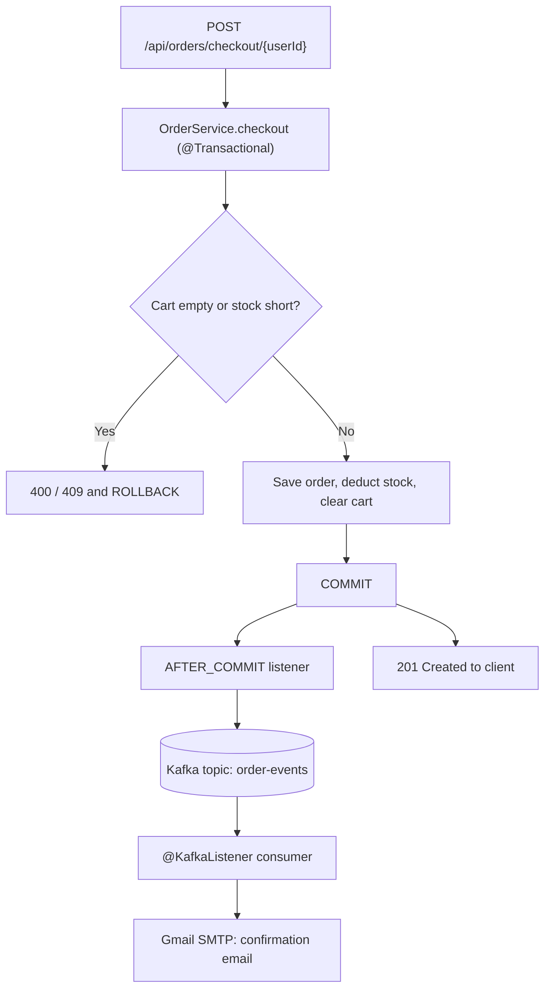

# E-Commerce Backend API

A backend REST API for a simplified e-commerce system, built with Spring Boot and PostgreSQL. This project focuses on solid backend fundamentals — proper layering, correct REST conventions, secure authentication, and deliberate data-modeling decisions — rather than breadth of features.

Built as a hands-on rebuild/deepening of Java backend skills, with an emphasis on understanding *why* each design decision was made, not just implementing it. A companion project, [`ai-service`](https://github.com/akhil900619/ai-service), is an independent Spring Boot microservice that this API calls over REST to generate AI-written product descriptions.

## Tech Stack

- **Java 17**
- **Spring Boot 4.x**
- **Spring Data JPA** (Hibernate)
- **Spring Security** (JWT-based authentication)
- **PostgreSQL**
- **Apache Kafka** (Spring for Apache Kafka) for event-driven order notifications
- **JavaMailSender** (Gmail SMTP) for confirmation emails
- **Docker** (used to run Kafka locally)
- **Maven**
- **Lombok**
- **JUnit 5 + Mockito**
- **Swagger / OpenAPI** (springdoc-openapi)

## Features

- **Full CRUD** for products, with soft delete (an `active` flag, not physical row deletion) so historical orders always resolve correctly
- **User registration and login**, with BCrypt password hashing and JWT-based authentication securing every endpoint except register/login/Swagger
- **Cart management** — add/update/remove items, with cumulative stock validation on add
- **Order checkout** — atomic, transactional checkout (`@Transactional`) with a two-pass validate-then-mutate flow, price snapshotting (`priceAtPurchase`) so historical orders are unaffected by later price changes, and stock deduction
- **Centralized exception handling** (`@ControllerAdvice`) — every failure mode (not found, duplicate email, insufficient stock, invalid credentials, validation errors, AI service unavailable) maps to a precise, correct HTTP status code with a clean JSON error body
- **AI-generated product descriptions** — calls the separate `ai-service` microservice over REST; if that service is unavailable, the request fails cleanly with a `503` rather than silently saving an incomplete product
- **Event-driven order confirmation** — after checkout commits, an `OrderPlacedEvent` is published to Apache Kafka (topic `order-events`); a separate `@KafkaListener` consumer then emails the customer. Publishing happens only *after* the database transaction commits (`@TransactionalEventListener(phase = AFTER_COMMIT)`), so no confirmation is ever sent for an order that rolled back, and order placement stays decoupled from email delivery
- **Unit tests** (JUnit 5 + Mockito) for core service-layer logic: checkout atomicity, stock validation, soft-delete behavior, duplicate-email checking, and password hashing — all fully isolated from the database via mocking
- **API documentation** via Swagger UI (`/swagger-ui/index.html`)
- Layered architecture: **Controller → Service → Repository → Database**
- Environment-variable-based configuration for all secrets (DB password, JWT secret, mail credentials) — nothing sensitive committed to source control

## Architecture: order checkout and events



## Known Limitations and Roadmap

- **Outbox pattern not implemented.** Publishing after commit avoids events for rolled-back orders, but if Kafka is unavailable right after the commit, that event is lost. A transactional outbox table is the full fix.
- **No dead-letter topic.** If sending an email keeps failing, Spring Kafka retries a few times and then skips the message. A dead-letter topic would keep failed events for inspection.
- **Concurrent checkouts of the last item.** Two simultaneous checkouts could both pass the stock check; pessimistic or optimistic locking (`@Version`) would close this.
- **Generic fallback error handler.** Unexpected exceptions still fall through to Spring's default `500`.
- **In progress:** Dockerization of the applications and cloud deployment.

## Design Notes

A few deliberate decisions worth calling out:

- **`BigDecimal` for all currency fields** — avoids floating-point rounding errors that `double`/`float` would introduce in financial calculations.
- **No service-layer interfaces** (e.g. `ProductService` is a plain class, not `ProductService` + `ProductServiceImpl`) — with only one implementation and no current need for polymorphism, an interface would add navigation overhead without real benefit.
- **Constructor injection over field injection** — keeps dependencies `final`, makes missing dependencies fail loudly at construction time, and made this codebase straightforward to unit test with Mockito's `@InjectMocks`.
- **Fetch-then-update pattern** for updates/deletes, rather than blindly saving/deleting by ID — protects against overwriting fields not included in a request payload, and ensures a clear "not found" error rather than a silent no-op.
- **Soft delete over hard delete** for products — since `OrderItem` holds a permanent reference to `Product`, hard-deleting a product once it's been ordered would corrupt order history. An `active` flag preserves the row while hiding it from normal browsing.
- **Stateless JWT authentication** — no server-side session storage, so the API can scale horizontally without shared session state. A custom `AuthenticationEntryPoint` ensures unauthenticated requests get a clean JSON `401`, not a container default error page.
- **`ai-service` as a separate microservice, not an embedded feature** — keeping the Gen AI integration in its own independently deployable process meant designing a real REST contract between the two services and handling the case where a dependency is down, rather than assuming it's always available.

## Running Locally

### Prerequisites
- Java 17+
- Maven
- PostgreSQL running locally, with a database created (e.g. `ecommerce_db`)
- Docker (to run Kafka locally)
- A Gmail account with an [App Password](https://support.google.com/accounts/answer/185833) (needed only for the confirmation emails)
- (Optional, for AI description generation) [`ai-service`](https://github.com/akhil900619/ai-service) running on port 8081

### Setup

1. Clone the repo:
   ```
   git clone https://github.com/akhil900619/ecommerce-backend-api.git
   ```

2. Set the required environment variables (see `.env.example` for the full list; Spring Boot does not read `.env` files automatically, so set them in your shell or IDE run configuration):
   ```
   DB_PASSWORD=your_postgres_password
   JWT_SECRET=a_long_random_base64_secret
   MAIL_USERNAME=your_gmail_address
   MAIL_APP_PASSWORD=your_gmail_app_password
   ```

3. Start Kafka (single broker on `localhost:9092`):
   ```
   docker compose up -d
   ```

4. Update `src/main/resources/application.properties` if your database name, username, or port differ from the defaults.

5. Run the application:
   ```
   mvn spring-boot:run
   ```

The API will be available at `http://localhost:8080`. Swagger docs at `http://localhost:8080/swagger-ui/index.html`.

### Running tests

```
mvn test
```

## API Endpoints (Current)

| Method | Endpoint | Auth required | Description |
|---|---|---|---|
| POST | `/api/users/register` | No | Register a new user |
| POST | `/api/users/login` | No | Log in, returns a JWT |
| POST | `/api/products` | Yes | Create a new product |
| GET | `/api/products` | Yes | List all active products |
| GET | `/api/products/{id}` | Yes | Get a single product by ID |
| PUT | `/api/products/{id}` | Yes | Update a product |
| DELETE | `/api/products/{id}` | Yes | Soft-delete a product |
| POST | `/api/products/{id}/generate-description` | Yes | Generate an AI product description via `ai-service` |
| GET | `/api/users/{id}` | Yes | Get a user by ID |
| GET | `/api/cart/{userId}` | Yes | View a user's cart |
| POST | `/api/cart/{userId}/items` | Yes | Add an item to the cart |
| PUT / DELETE | `/api/cart/{userId}/items/{itemId}` | Yes | Update or remove a cart item |
| POST | `/api/orders/checkout/{userId}` | Yes | Checkout the cart into an order (publishes an order event after commit) |
| GET | `/api/orders/user/{userId}` | Yes | Get a user's order history |

## Author

**Akhil Sharma**
[LinkedIn](https://www.linkedin.com/in/akhil-sharma-078829b9/) · akhil900619@gmail.com
